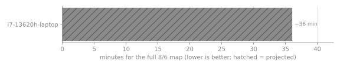
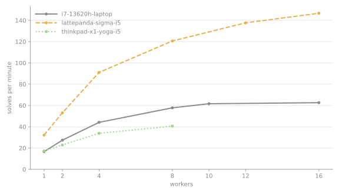
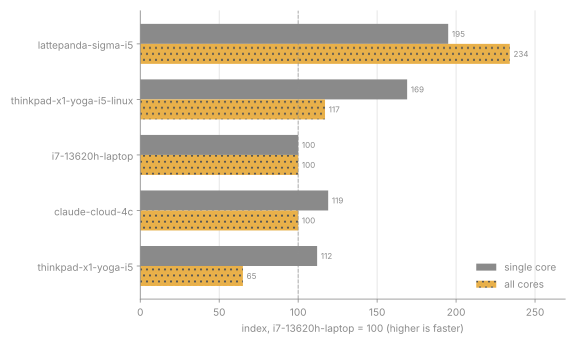

# srmbench: machine benchmark for the SRM design tool

srmbench times the real workload of this tool on your machine: the Gmsh mesh, the NGSolve nonlinear solve, and the process pool that builds flux-linkage and torque maps for the 8/6 and 12/8 reference designs. It is not a synthetic kernel, so the numbers are the waits you will feel in the tool. It also checks that the solver returns the right numbers on this machine, which catches bad RAM, an unstable overclock or a failing cooler. Use it to choose hardware, to plan (how long a map or a search takes, how many workers to use) and as a stability check. Design details are in `docs/superpowers/specs/2026-10-14-srmbench-design.md`.

## Requirements

| Platform | Supported |
|---|---|
| Windows 10 1803+ or Windows 11, x64 | yes |
| Linux x86_64, glibc 2.28+ (Ubuntu 20.04+, Debian 10+, RHEL/Rocky/Alma 8+, Fedora, WSL2, Proxmox VM or LXC, Claude cloud) | yes |
| Linux aarch64 (Raspberry Pi, Graviton, Ampere), Windows on ARM | no, there are no Gmsh or NGSolve wheels |
| Linux musl (Alpine), 32-bit systems | no, there are no wheels |
| macOS | not in v1 |

- RAM: 4 GB for `quick` and `standard`, 8 GB for `long` (a machine passes at 90 % of the figure, because Windows and VMs report less than the installed amount). Each worker process needs about 0.3 GB at the `screening` mesh (measured peak, about 43 000 nodes); `full`-mesh workers need more, roughly in proportion to the node count (about 82 000 nodes for the 8/6). The worker count is capped at (available RAM - 1 GB) / RAM per worker.
- Disk: 2 GB free on the drive that holds `bench/.runtime/`. The environment takes about 0.7 GB on disk (about 195 MB download).
- CPU: at least 2 logical CPUs.
- Network for the first setup only: GitHub (the pinned `uv`), PyPI and python-build-standalone (packages and Python 3.12). Later runs need no network, except for publishing results.
- Git: the repository must be cloned. The benchmark installs the engine from the checkout next to it (`..`), so a copied `bench/` folder alone does not work. The publish tests in the self-test build temporary repositories and need git 2.28 or newer.
- Linux: Gmsh and NGSolve need a few system libraries. On first run the script installs them with `apt-get` (`libglu1-mesa libxcursor1 libxft2 libxinerama1 libquadmath0 libgfortran5 libopenblas0`) or `dnf`/`yum` (`mesa-libGLU libXcursor libXft libXinerama libquadmath libgfortran openblas`), using `sudo` unless you are root. If there is no root, no `sudo` or an unknown package manager, it prints the exact command and stops.

Everything the script installs goes under `bench/.runtime/` (uv, Python, the virtual environment, the uv cache). Deleting that folder removes all of it. The scripts never touch the repository's own `.venv` or any system setting, apart from the Linux libraries above.

## Tutorial: first run

### Windows (10 or 11)

1. **Get the repository.** Install Git for Windows (https://git-scm.com/download/win) if `git --version` fails. The repository is private, so sign in when Git asks (a browser window opens). Then, in PowerShell:
   ```powershell
   git clone https://github.com/yusnimawl/srm-forge.git
   cd srm-forge
   ```
   Already cloned? `cd` into it and run `git pull`.
2. **Prepare the machine.** Plug in the charger, set Settings > System > Power > Power mode to "Best performance", close the browser and other heavy programs.
3. **Start it.** Double-click `bench\run.bat` in Explorer, or in the terminal:
   ```powershell
   bench\run.bat
   ```
   The first run downloads about 195 MB (uv, Python 3.12, the packages) into `bench\.runtime\`. That takes a few minutes; later runs start in seconds.
4. **Answer the questions.**
   - Machine label: a short name for this machine, for example `laptop-asus-i5`. Lowercase letters, digits and `-` only. It is remembered. The reference laptop must use `i7-13620h-laptop`.
   - Tier: `1` quick (minutes), `2` standard (about 15 min on the reference laptop), `3` long (hours). Start with quick.
   - If it warns about battery or a busy CPU, fix that and answer `N`, then run again.
5. **Wait.** Each step prints a timestamped line. Do not use the machine meanwhile.
6. **Read the summary** it prints at the end: single-solve time, recommended workers, projected map and search times, correctness. The result is saved in `bench\results\<label>\` and this README is rebuilt.
7. **Publish** (optional): answer `y` to "Commit and push results?". It commits only the result and this README and pushes them. It refuses if your branch has other unpushed commits.
8. **Finish:** "Delete the benchmark environment?" `y` frees about 0.7 GB (the next run downloads it again); `N` keeps it for faster reruns.
9. **See the comparison:** open `bench/README.md` on GitHub. The table and charts at the bottom show every machine that has published.

### Linux (Ubuntu, Debian, Fedora, WSL2, Proxmox, cloud)

1. **Get the repository.**
   ```sh
   sudo apt-get install -y git        # Fedora: sudo dnf install -y git
   git clone https://github.com/yusnimawl/srm-forge.git
   cd srm-forge
   ```
   The repository is private: use `gh auth login` (GitHub CLI) or a personal access token as the password when Git asks.
2. **Prepare the machine.** Laptops: plug in. Close heavy programs. On WSL, the Windows side must also be idle.
3. **Start it as your normal user** (not with `sudo`; the script asks for `sudo` itself only to install the Gmsh libraries the first time):
   ```sh
   sh bench/run.sh
   ```
   The first run downloads about 195 MB into `bench/.runtime/`.
4. **Answer the same questions** as on Windows (label, tier, warnings).
5. **Wait, read the summary, publish if you want, choose keep or delete** — the same as Windows steps 5 to 8.
6. **Headless or cloud machine** (no questions asked, nothing published):
   ```sh
   sh bench/run.sh --tier quick --label my-server --yes --keep --no-push
   ```
   Then commit the result yourself with `git add bench/results bench/README.md`, `git commit`, `git push`, or rerun later with `--push`.

### Running it again

- Rerun the same command; it skips the download. A new result file is added; the README shows each machine's latest run and lists the earlier ones in its details.
- After `git pull` on a machine that changed nothing locally, `bench/run.bat --report-only` (Windows) or `sh bench/run.sh --report-only` (Linux) rebuilds the comparison from everything published so far.

## How to run

Windows: double-click `bench\run.bat`, or in a terminal:

```powershell
bench\run.bat --tier quick
```

Linux, WSL, Proxmox, cloud:

```sh
./bench/run.sh --tier quick
```

Without `--tier`, a menu asks. Unattended (cloud, scripts), with no prompts, keeping the environment and not publishing:

```sh
./bench/run.sh --tier standard --label my-machine --yes --keep --no-push
```

Claude cloud sessions are Ubuntu 24.04 on 4 vCPU and 16 GB RAM, running as root. A command times out after 2 minutes by default, and a background command stops after 30 more minutes. Any tier can exceed the default, even `quick` on a first run (the setup downloads about 195 MB first). Set both `BASH_DEFAULT_TIMEOUT_MS` and `BASH_MAX_TIMEOUT_MS` in the cloud environment (for example `3600000`), or run the benchmark as a background command. `long` is still not advised there.

### Before you run

- The reference laptop must run with `--label i7-13620h-laptop` (the name in `bench/reference-machine.txt`). Under any other label the index columns and the index chart stay empty.
- Plug in the charger. Laptops throttle on battery.
- On Windows, set the power mode to "Best performance" (Settings, System, Power). The benchmark cannot read this setting reliably.
- Close heavy programs (browsers, sync clients, memory cleaners). The benchmark warns when other processes use more than 20 % of the CPU, and the numbers then are not representative.
- Leave the machine alone until it finishes.

### Tiers

Times are for the reference laptop (i7-13620H, 10 cores, 16 threads, 16 GB). Slower machines take longer.

| Tier | About | What it runs |
|---|---|---|
| `quick` | 3 min | meshes, single solves, correctness points, throughput at the physical and the logical core count |
| `standard` | 15 min | quick, plus throughput at 1, 2, 4, ... workers, an 8/6 `screening` map and a 5 minute sustained run |
| `long` | 2.2 h | standard with a 20 minute sustained run, plus the `full` maps of the 8/6 and the 12/8 with the overlap map and held-out checks |

### Flags

| Flag | Meaning |
|---|---|
| `--tier quick\|standard\|long` | what to run; without it a menu asks |
| `--label NAME` | machine label: lowercase letters, digits and `-`, up to 40 characters; without it you are asked once (the host name is the default) and the answer is remembered in `.runtime/label` |
| `--workers N` | cap the largest worker count (the default is capped by CPUs and RAM) |
| `--yes` | no prompts; the finish defaults to `--keep` and `--no-push` unless you give the flags |
| `--keep` / `--delete` / `--keep-full` | keep the environment, delete it, or keep it and also install the rest of the SRM design tool so `srmweb` runs from it (the web frontend build then needs Node: `cd web; npm ci; npm run build`) |
| `--push` / `--no-push` | commit and push the results, or not |
| `--report-only` | rebuild this README block and the charts from `results/` and exit |
| `--self-test` | run the benchmark's own unit tests and exit |

### Notes

- On Windows, if you press Ctrl+C, answer `N` to "Terminate batch job (Y/N)?". Then the finish step still runs. The interrupted run saves nothing.
- Publishing commits only `bench/results` and `bench/README.md`. It refuses to run when your branch has unpushed commits (push your own work first), and when any other local change would block `git pull --rebase`. Before pulling it restores `bench/README.md` and the charts from git, so do not hand-edit `bench/README.md` and publish in the same run: commit prose edits first.
- A failed correctness check does not stop the run. The result records it and the row is marked with a cross.

## How to read the results

- Full map chart: minutes to build a `full` 8/6 map, which is the wait you feel in the tool. Lower is better. Hatched bars are projected from the throughput, not measured.
- Scaling chart: solves per minute against workers. Where the line flattens, more workers stop helping. The recommended worker count is the smallest one that reaches 95 % of the best throughput, capped by RAM; use it for `SRMWEB_WORKERS`.
- Index chart: single-core and all-core speed relative to the reference machine (100). Higher is faster.
- `~` in the table marks a projected value. Search time (24 candidates) is a rough projection: the real search adds the stage-1 filter and the turns scan.
- A cross in the correctness column means the solver returned wrong numbers on that machine. Suspect RAM errors, an overclock or heat, and run again.
- Throttle is the sustained throughput in the last 20 % of the batches against the first 20 % (standard and long only). A large negative value means the machine slows down under load.
- Batch throughput includes starting the worker pool for every batch, which costs more on Windows, so Windows all-core figures are slightly pessimistic. The long tier's projection error (in the machine's details) shows how large this effect is. The all-core index uses the best measured throughput, so tiers compare.
- Only results with the current benchmark version are compared. Older ones are listed separately.

## Not measured

Temperature and GPU. There is no reliable cross-platform temperature reading without administrator rights, so the sustained run stands in for it.

<!-- srmbench:results:start -->






| Machine | CPU | Cores | RAM (GB) | OS | Tier | Single solve (s) | Workers | Screening map (min) | Full map (min) | Search of 24 (h) | RAM per worker (GB) | Throttle (%) | Correct | Index single/all |
|---|---|---|---|---|---|---|---|---|---|---|---|---|---|---|
| [lattepanda-sigma-i5](#machine-lattepanda-sigma-i5) | 13th Gen Intel(R) Core(TM) i5-1340P | 12C/16T | 33 | Linux (glibc 2.43) | standard | 1.8 | 16 | 1.7 | ~15 | ~6.1 | 0.47 | +2.2 | ✓ | 195/234 |
| [thinkpad-x1-yoga-i5-linux](#machine-thinkpad-x1-yoga-i5-linux) | 11th Gen Intel(R) Core(TM) i5-1145G7 @ 2.60GHz | 4C/8T | 16 | Linux (glibc 2.43) | standard | 2.0 | 8 | 3.4 | ~31 | ~13 | 0.47 | -1.5 | ✓ | 169/117 |
| [i7-13620h-laptop](#machine-i7-13620h-laptop) | 13th Gen Intel(R) Core(TM) i7-13620H | 10C/16T | 17 | Windows 11 | standard | 3.4 | 10 | 4.1 | ~36 | ~14 | 0.29 | +0.8 | ✓ | 100/100 |
| [claude-cloud-4c](#machine-claude-cloud-4c) | Intel(R) Xeon(R) Processor @ 2.10GHz | 4C/4T | 17 | Linux (glibc 2.39) | quick | 2.9 | 4 | ~5.8 | ~38 | ~15 | 0.46 | – | ✓ | 119/100 |
| [thinkpad-x1-yoga-i5](#machine-thinkpad-x1-yoga-i5) | 11th Gen Intel(R) Core(TM) i5-1145G7 @ 2.60GHz | 4C/8T | 17 | Windows 11 | standard | 3.1 | 8 | 4.4 | ~60 | ~24 | 0.30 | +8.7 | ✓ | 112/65 |

`~` marks a projected value (a map not run, estimated from the batch throughput); the search is always projected. Correct: ✓ passed, ✗ failed, – not checked.

<details id="machine-lattepanda-sigma-i5">
<summary><b>lattepanda-sigma-i5</b> – 13th Gen Intel(R) Core(TM) i5-1340P, standard, 2026-10-16</summary>

- Machine: 13th Gen Intel(R) Core(TM) i5-1340P; 12 cores, 16 threads; 32.8 GB RAM; Linux (glibc 2.43) (#38-Ubuntu SMP PREEMPT_DYNAMIC Fri Sep  4 09:10:14 UTC 2026, x86_64); Python 3.12.14
- Versions: engine commit 6aa0228, gmsh 4.15.2, matplotlib 3.11.2, ngsolve 6.2.2608, numpy 2.5.4, psutil 7.2.2, scipy 1.18.1, srmcore 0.5.0; srmbench 1.0; lock 6ff044847626
- Run: 2026-10-16T17:44:15+07:00 to 2026-10-16T17:54:52+07:00, tier standard, status complete
- Result file: [2026-10-16T1744-standard.json](results/lattepanda-sigma-i5/2026-10-16T1744-standard.json)

**Mesh (8/6)**

| Preset | Seconds | Nodes | Grid points |
|---|---|---|---|
| screening | 3.78 | 42 914 | 360 |
| full | 5.62 | 81 968 | 1008 |

**Single solve (8/6)**

| Preset | Median (s) | Samples (s) |
|---|---|---|
| screening | 1.764 | 1.737, 1.764, 1.773, 1.770, 1.749 |
| full | 3.923 | 3.876, 3.942, 3.923 |

**Correctness points:** pass; mesh differs: 42914 nodes vs 42935

**Batches**

| Workers | Points | Seconds | Solves per minute | Peak RAM per worker (GB) |
|---|---|---|---|---|
| 1 | 8 | 14.91 | 32.2 | – |
| 2 | 16 | 18.07 | 53.1 | 0.46 |
| 4 | 32 | 21.09 | 91.1 | 0.46 |
| 8 | 64 | 31.84 | 120.6 | 0.47 |
| 12 | 96 | 41.84 | 137.7 | 0.47 |
| 16 | 128 | 52.36 | 146.7 | 0.47 |

**Recommended workers:** 16 (uncapped choice 16, RAM cap 16)

**Screening map 8/6:** 103.5 s, 360 points, 16 workers, correctness pass; key numbers: aligned_angle 0, i_max 20, la 0.0328289, la_lu 9.16354, lu 0.00358256, peak_torque 12.4246, psi_max 0.320169, unaligned_angle 0.523599

**Sustained load:** 5 min at 16 workers, throttle +2.2 %; trace (time: solves per minute): 54 s: 143.4; 106 s: 145.4; 159 s: 145.7; 212 s: 145.3; 265 s: 144.8; 317 s: 146.6

**Scaling**

| Workers | Solves per minute | Speed-up over 1 worker(s) | Efficiency (%) |
|---|---|---|---|
| 1 | 32.2 | 1.00 | 100 |
| 2 | 53.1 | 1.65 | 83 |
| 4 | 91.1 | 2.83 | 71 |
| 8 | 120.6 | 3.75 | 47 |
| 12 | 137.7 | 4.27 | 36 |
| 16 | 146.7 | 4.55 | 28 |

</details>

<details id="machine-thinkpad-x1-yoga-i5-linux">
<summary><b>thinkpad-x1-yoga-i5-linux</b> – 11th Gen Intel(R) Core(TM) i5-1145G7 @ 2.60GHz, standard, 2026-10-29</summary>

- Machine: 11th Gen Intel(R) Core(TM) i5-1145G7 @ 2.60GHz; 4 cores, 8 threads; 15.9 GB RAM; Linux (glibc 2.43) (#38-Ubuntu SMP PREEMPT_DYNAMIC Fri Sep  4 09:10:14 UTC 2026, x86_64); Python 3.12.14
- Versions: engine commit 1e1c1df, gmsh 4.15.2, matplotlib 3.11.2, ngsolve 6.2.2608, numpy 2.5.4, psutil 7.2.2, scipy 1.18.1, srmcore 0.7.0; srmbench 1.0; lock 6ff044847626
- Run: 2026-10-29T05:06:52+07:00 to 2026-10-29T05:18:17+07:00, tier standard, status complete
- Result file: [2026-10-29T0506-standard.json](results/thinkpad-x1-yoga-i5-linux/2026-10-29T0506-standard.json)

**Mesh (8/6)**

| Preset | Seconds | Nodes | Grid points |
|---|---|---|---|
| screening | 4.81 | 42 914 | 360 |
| full | 7.15 | 81 968 | 1008 |

**Single solve (8/6)**

| Preset | Median (s) | Samples (s) |
|---|---|---|
| screening | 2.031 | 2.014, 2.025, 2.052, 2.109, 2.031 |
| full | 4.604 | 4.587, 4.607, 4.604 |

**Correctness points:** pass; mesh differs: 42914 nodes vs 42935

**Batches**

| Workers | Points | Seconds | Solves per minute | Peak RAM per worker (GB) |
|---|---|---|---|---|
| 1 | 8 | 17.26 | 27.8 | – |
| 2 | 16 | 21.96 | 43.7 | 0.46 |
| 4 | 32 | 29.87 | 64.3 | 0.47 |
| 8 | 64 | 52.52 | 73.1 | 0.46 |

**Recommended workers:** 8 (uncapped choice 8, RAM cap 8)

**Screening map 8/6:** 204.6 s, 360 points, 8 workers, correctness pass; key numbers: aligned_angle 0, i_max 20, la 0.0328289, la_lu 9.16354, lu 0.00358256, peak_torque 12.4246, psi_max 0.320169, unaligned_angle 0.523599

**Sustained load:** 5 min at 8 workers, throttle -1.5 %; trace (time: solves per minute): 52 s: 73.3; 105 s: 73.0; 157 s: 73.3; 210 s: 72.9; 262 s: 73.3; 316 s: 72.2

**Scaling**

| Workers | Solves per minute | Speed-up over 1 worker(s) | Efficiency (%) |
|---|---|---|---|
| 1 | 27.8 | 1.00 | 100 |
| 2 | 43.7 | 1.57 | 79 |
| 4 | 64.3 | 2.31 | 58 |
| 8 | 73.1 | 2.63 | 33 |

</details>

<details id="machine-i7-13620h-laptop">
<summary><b>i7-13620h-laptop</b> – 13th Gen Intel(R) Core(TM) i7-13620H, standard, 2026-10-15</summary>

- Machine: 13th Gen Intel(R) Core(TM) i7-13620H; 10 cores, 16 threads; 16.9 GB RAM; Windows 11 (10.0.26200, AMD64); Python 3.12.14
- Versions: engine commit 905a87b, gmsh 4.15.2, matplotlib 3.11.2, ngsolve 6.2.2608, numpy 2.5.4, psutil 7.2.2, scipy 1.18.1, srmcore 0.4.0; srmbench 1.0; lock 3e7c9e8c8462
- Run: 2026-10-15T17:11:06+07:00 to 2026-10-15T17:28:45+07:00, tier standard, status complete
- Result file: [2026-10-15T1711-standard.json](results/i7-13620h-laptop/2026-10-15T1711-standard.json)

**Mesh (8/6)**

| Preset | Seconds | Nodes | Grid points |
|---|---|---|---|
| screening | 7.39 | 42 935 | 360 |
| full | 10.91 | 81 984 | 1008 |

**Single solve (8/6)**

| Preset | Median (s) | Samples (s) |
|---|---|---|
| screening | 3.433 | 3.730, 3.433, 3.554, 3.317, 3.158 |
| full | 7.535 | 7.674, 7.403, 7.535 |

**Correctness points:** pass

**Batches**

| Workers | Points | Seconds | Solves per minute | Peak RAM per worker (GB) |
|---|---|---|---|---|
| 1 | 8 | 28.86 | 16.6 | – |
| 2 | 16 | 35.01 | 27.4 | 0.29 |
| 4 | 32 | 43.49 | 44.1 | 0.29 |
| 8 | 64 | 66.42 | 57.8 | 0.29 |
| 10 | 80 | 77.86 | 61.7 | 0.29 |
| 16 | 128 | 122.63 | 62.6 | 0.29 |

**Recommended workers:** 10 (uncapped choice 10, RAM cap 16)

**Screening map 8/6:** 244.0 s, 360 points, 10 workers, correctness pass; key numbers: aligned_angle 0, i_max 20, la 0.0328289, la_lu 9.16354, lu 0.00358256, peak_torque 12.4247, psi_max 0.320169, unaligned_angle 0.523599

**Sustained load:** 5 min at 10 workers, throttle +0.8 %; trace (time: solves per minute): 74 s: 64.7; 148 s: 64.7; 222 s: 65.0; 297 s: 64.5; 370 s: 65.2

**Scaling**

| Workers | Solves per minute | Speed-up over 1 worker(s) | Efficiency (%) |
|---|---|---|---|
| 1 | 16.6 | 1.00 | 100 |
| 2 | 27.4 | 1.65 | 82 |
| 4 | 44.1 | 2.65 | 66 |
| 8 | 57.8 | 3.48 | 43 |
| 10 | 61.7 | 3.71 | 37 |
| 16 | 62.6 | 3.77 | 24 |

</details>

<details id="machine-claude-cloud-4c">
<summary><b>claude-cloud-4c</b> – Intel(R) Xeon(R) Processor @ 2.10GHz, quick, 2026-10-29</summary>

- Machine: Intel(R) Xeon(R) Processor @ 2.10GHz; 4 cores, 4 threads; 16.9 GB RAM; Linux (glibc 2.39) (#1 SMP PREEMPT_DYNAMIC @0, x86_64); Python 3.12.14
- Versions: engine commit 35cdccb, gmsh 4.15.2, matplotlib 3.11.2, ngsolve 6.2.2608, numpy 2.5.4, psutil 7.2.2, scipy 1.18.1, srmcore 0.7.0; srmbench 1.0; lock 6ff044847626
- Run: 2026-10-29T21:27:39+00:00 to 2026-10-29T21:29:08+00:00, tier quick, status complete
- Result file: [2026-10-29T2127-quick.json](results/claude-cloud-4c/2026-10-29T2127-quick.json)

**Mesh (8/6)**

| Preset | Seconds | Nodes | Grid points |
|---|---|---|---|
| screening | 5.78 | 42 914 | 360 |
| full | 8.50 | 81 968 | 1008 |

**Single solve (8/6)**

| Preset | Median (s) | Samples (s) |
|---|---|---|
| screening | 2.891 | 3.121, 2.911, 2.676, 2.891, 2.646 |
| full | 6.769 | 7.253, 6.439, 6.769 |

**Correctness points:** pass; mesh differs: 42914 nodes vs 42935

**Batches**

| Workers | Points | Seconds | Solves per minute | Peak RAM per worker (GB) |
|---|---|---|---|---|
| 4 | 32 | 30.56 | 62.8 | 0.46 |

**Recommended workers:** 4 (uncapped choice 4, RAM cap 4)

</details>

<details id="machine-thinkpad-x1-yoga-i5">
<summary><b>thinkpad-x1-yoga-i5</b> – 11th Gen Intel(R) Core(TM) i5-1145G7 @ 2.60GHz, standard, 2026-10-16</summary>

- Machine: 11th Gen Intel(R) Core(TM) i5-1145G7 @ 2.60GHz; 4 cores, 8 threads; 16.9 GB RAM; Windows 11 (10.0.26300, AMD64); Python 3.12.14
- Versions: engine commit d15182d, gmsh 4.15.2, matplotlib 3.11.2, ngsolve 6.2.2608, numpy 2.5.4, psutil 7.2.2, scipy 1.18.1, srmcore 0.5.0; srmbench 1.0; lock e541a4325f78
- Run: 2026-10-16T02:05:50+07:00 to 2026-10-16T02:20:18+07:00, tier standard, status complete
- Result file: [2026-10-16T0205-standard.json](results/thinkpad-x1-yoga-i5/2026-10-16T0205-standard.json)
- Warning: The CPU is 33% busy with other work; close other programs for a representative timing.

**Mesh (8/6)**

| Preset | Seconds | Nodes | Grid points |
|---|---|---|---|
| screening | 8.42 | 42 935 | 360 |
| full | 11.23 | 81 984 | 1008 |

**Single solve (8/6)**

| Preset | Median (s) | Samples (s) |
|---|---|---|
| screening | 3.053 | 3.053, 3.069, 3.010, 2.984, 3.164 |
| full | 7.340 | 6.930, 7.340, 7.412 |

**Correctness points:** pass

**Batches**

| Workers | Points | Seconds | Solves per minute | Peak RAM per worker (GB) |
|---|---|---|---|---|
| 1 | 8 | 27.77 | 17.3 | – |
| 2 | 16 | 42.00 | 22.9 | 0.30 |
| 4 | 32 | 56.73 | 33.8 | 0.30 |
| 8 | 64 | 94.57 | 40.6 | 0.30 |

**Recommended workers:** 8 (uncapped choice 8, RAM cap 8)

**Screening map 8/6:** 261.7 s, 360 points, 8 workers, correctness pass; key numbers: aligned_angle 0, i_max 20, la 0.0328289, la_lu 9.16354, lu 0.00358256, peak_torque 12.4247, psi_max 0.320169, unaligned_angle 0.523599

**Sustained load:** 5 min at 8 workers, throttle +8.7 %; trace (time: solves per minute): 80 s: 47.7; 163 s: 46.4; 244 s: 47.8; 318 s: 51.9

**Scaling**

| Workers | Solves per minute | Speed-up over 1 worker(s) | Efficiency (%) |
|---|---|---|---|
| 1 | 17.3 | 1.00 | 100 |
| 2 | 22.9 | 1.32 | 66 |
| 4 | 33.8 | 1.96 | 49 |
| 8 | 40.6 | 2.35 | 29 |

</details>
<!-- srmbench:results:end -->
