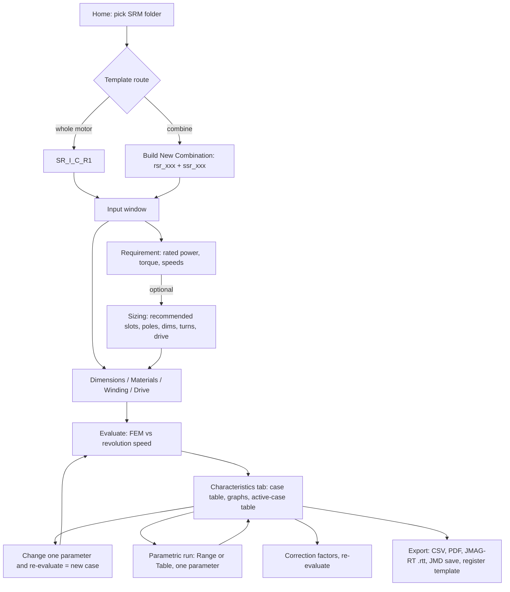

# JMAG-Express: Switched Reluctance Motor (SRM) Reference

Extracted from the JMAG-Express Online Web Help (https://express.jmag-international.com/express/help/en/, pages last updated 2025-01-27, © JSOL Corporation). This is a condensed reference of everything the help says that applies to switched reluctance motors. Wording is paraphrased; consult the original pages for exact text. Bracketed names like [DC Voltage] are the UI labels used in JMAG-Express.

Source pages: `01_motor.htm`, `10_temp/temp_08.htm`, `03_design/design_03.htm`, `05_sizing/sizing_00.htm`, `11_input/input_02..05.htm`, `11_input/input_11.htm`, `12_result/result_04.htm`.

Contents: Part C adds parameter detail, screen layout and diagrams. Part A is the end-to-end workflow and feature set (template, specs, sizing, evaluation, parametric runs, maps, thermal, corrections, export, data management), with notes on what does and does not apply to SRMs. Part B (sections 1-6) is the SRM-specific detail (templates, parameters, results).

# Part A: Workflow and Features

Overall flow in JMAG-Express Online: **select template -> enter specifications (dimensions, materials, winding, drive) -> optionally run sizing -> evaluate (FEM) -> review graphs/tables -> parametric sweeps and case comparison -> export/save.**

Important: JMAG-Express is tuned for evaluation speed, not accuracy. The help says to use the JMAG-Designer desktop application for high-precision evaluation. Also, the online service cannot be operated separately in multiple browser windows or tabs.

## A0. SRM feature support at a glance

| Feature | SRM supported? | Source detail |
|---|---|---|
| Template selection / combine rotor+stator | Yes | A1 |
| Dimensions, materials, winding, drive input | Yes | A2, Part B |
| Sizing function | Yes | A3, section 5 |
| Characteristics evaluation (FEM) vs. revolution speed | Yes | A4, section 4 |
| Parametric evaluation | Yes (one parameter at a time) | A5 |
| Efficiency / power maps (N-T maps) | **No** (brushless and induction only) | A6 |
| Temperature (thermal equivalent circuit) evaluation | **No** (brushless and induction only) | A7 |
| Correction factors | Yes, though available types vary by motor | A8 |
| JMAG-RT model export (flux linkage/inductance, resistance) | Yes (not for 6/9-phase brushless and 6/9/single-phase induction); iron loss is only included for brushless motors | A9 |
| CSV export, PDF report, custom report layouts | Yes | A9, A10 |
| Save as JMD file, register user template, cloud storage | Yes | A11 |

## A1. Selecting a template

Two routes, both start from the [Home] window and the motor folder (for SRM, the Switched Reluctance Motor folder):

1. **Whole-motor template**: click the template (for SRM, `SR_I_C_R1`). It contains both rotor and stator geometry.
2. **Combine rotor and stator templates**: click [Build New Combination], pick a template under [Rotor] and one under [Stator] in [Combination], then [OK].

After choosing, the [Input] window opens. Left side tabs for entering parameters: [Requirement], [Dimension], [Material], [Winding], [Drive] (plus [Field Coil] only for externally excited/wound-field machines, and [Thermal] when temperature evaluation is on). Right side tabs show the result of your inputs: [Motor Diagram], [Winding Diagram], [Slot Diagram], and [Characteristics].

Changing the template later:

- **Same category** (for example swapping the SRM rotor tooth shape): in the [Dimensions] tab click [Modify] next to [Rotor] or [Stator], pick a template in [Select Template], click [OK].
- **Different category**: use [File] > [Home] and re-select (the current template and unsaved inputs are discarded).
- Entered specifications are **not saved automatically**.

Template properties ([Template] > [Property] in the [Input] window):

- Length unit: m, cm, mm, um, nm, in, ft, mil; decimal places 0 to 10.
- Temperature unit: Celsius, Fahrenheit, Kelvin.
- Derived units (W/(m^2 K), W/(m K), K/W) are fixed. Changing units does not change stored evaluation result values.

There is also a smartphone version of the UI with the same functions arranged differently (a Dimensions Panel, a Pop Up Menu with [Input], [Graph], [Parametric] and so on, and a Settings menu). Undo/redo is PC-only.

## A2. Entering motor specifications

Done in the [Input] window tabs:

- **[Dimension]**: motor dimensions, number of poles, number of slots, and so on. Clicking a parameter's text box draws a red/blue dimension indicator on the model for length parameters (rotor inner/outer diameter, gap width). The model updates live as you type; [Fit] zooms to the whole motor.
- **[Material]**: choose a part (for SRM: stator core, coil, rotor core, shaft), then set its material properties. Input items depend on the part type. Material data can be uploaded or downloaded from storage.
- **[Winding]**: phases, connection, turns, wire or resistance (see section 3.3).
- **[Drive]**: DC voltage, conduction angles, current limit, speed (see section 3.4).
- **Undo/Redo** ([Edit] menu or the Input window buttons), PC only.
- **[Requirement]** tab: target values used by the sizing function (A3). It is not available for single-phase induction motors.

## A3. Sizing function (recommended specs from a requirement)

Steps:

1. Open the [Requirement] tab in the [Input] window.
2. Tick the targets to use and type values:
   - [Rated Power, kW] (0.01 to 100000 kW),
   - [Maximum Torque, Nm] (steady-state torque),
   - [Rated Revolution Speed, rpm] (target speed at maximum torque),
   - [Maximum Revolution Speed, rpm] (an operating-range speed).
   The help notes the relation `Rated output (W) = Max torque (N m) x 2 pi x (Rated speed (rpm)/60)` and shows a warning when the three values are inconsistent.
3. Under [Sizing Parameter], choose which design parameters to fix and give their values.
4. Click [Apply]. The [Dimensions], [Materials], [Winding], and [Drive] tabs are updated with recommended values.

Notes: default outer diameter to stack height ratio is 1:1; invalid slot/pole combinations are adjusted automatically; warnings appear next to bad inputs; if geometry cannot be updated with the computed slot/pole counts, nearest feasible values are applied and a message gives the recommended slots/poles, which you can set manually. Sizing results are a starting point to refine by hand. Details for SRM are in section 5.

## A4. Running an evaluation and reviewing results

- Click [Evaluate] in the [Input] window (or [Characteristics] > [Evaluate]). JMAG-Express runs an FEM-based calculation of characteristics versus the evaluation axis (for SRM: revolution speed).
- Results appear on the [Characteristics] tab, which has three frames: (1) the **design case table** (compare specs and results across cases), (2) **result graphs** (curves from multiple cases), (3) the **characteristics table** for the active case. On the smartphone version, a [Graph] window and table windows are used instead.
- Results history is kept: change an input and re-evaluate, and a **new case** is added rather than overwriting.

Graph tools: click a curve point for X/Y values; Zoom, Pan, Zoom In, Zoom Out, Fit, Toggle Spike Lines, Show Closest Data on Hover, a data-table view (PC only; right-click copies cells), and Edit Graph Property ([Graph Title], [Graph Type], [Line Option], [Axis Property] in the [Graph Line Property] dialog; PC only).

Case table tools:

- Per-case **flags** and **comments**.
- The [Graph] column check box controls whether a case's curve appears in the graphs; right-click for [Check on]/[Check off] for selected, marked, or all cases, and for filtering.
- Right-click a flag column for [Filter by Flag] and [Reset Filter].
- Right-click a case for [Apply Selected Case] (copy its settings into the current case), [Copy], [Copy All], and [Delete Selected Cases].

## A5. Parametric evaluation

Runs several cases while varying **one** design parameter (geometry, winding, or drive value) and shows the response.

1. Click the parameter on its tab in the [Input] window and click [Parametric Mode] (or [Characteristics] > [Parametric Mode], or click a parameter cell in the bottom area of the [Characteristics] tab; changeable cells are yellow).
2. In [Parametric Range Input], choose a method:
   - [Range]: [Start], [End], [Division] with equal intervals. Example: start 0, end 30, division 3 gives values 0, 10, 20, 30.
   - [Table]: enter values directly; for materials, pick a material from the pull-down for each cell.
3. Run. Each value becomes a case in the case table and graphs.

Limits: only a single design parameter per parametric run. Not changeable parametrically: all [Requirement] parameters; in [Dimensions] the gap type, units, and fins presence; in [Materials] the category; in [Winding] the wire property/setting type and go/return of manual winding; in [Drive] the drive mode and X-axis; in [Thermal] contact state and cooling method.

For SRM design work this is the main way to sweep, for example, turn-on angle, conduction width, current limit, turns, or any single dimension.

## A6. Efficiency / power maps (not available for SRM)

The Map function builds speed-torque (N-T) maps of efficiency, power, loss components, currents, voltage, and power factor, using voltage and current limits. In the current version it covers only **brushless motors** and **induction motors (3/6/9-phase)**; it cannot be used for single-phase induction motors, and the help lists no SRM maps. It is recorded here because it is a headline JMAG-Express feature and so you know to plan your own SRM map tooling (for example an N-T efficiency map built from your own simulation pipeline).

How it works for the supported motors (useful as a design reference for your own SRM map):

- Maps: N-T-Efficiency, Power, TotalLoss, CopperLoss, IronLoss, CopperAndIronLoss, MechanicalLoss, plus brushless Id/Iq/Iam/V/PowerFactor/PhaseAngle and induction I/V/Slip/stator and rotor copper loss. Regenerative operation appears as negative torque. Linear interpolation is used between operating points. Up to 4 cases can be mapped at once.
- Settings ([Map Setting] dialog via [Map] button or [Characteristics] > [Map]): [Control] (fixed to [Maximum Power] in the current version: for brushless it searches current amplitude and phase for maximum torque, for induction it searches current amplitude and slip), [Maximum Voltage, V], [Maximum Current, A], [Maximum Speed, rpm] (all must be nonzero).
- Voltage and current limit conventions: brushless, star connection `sqrt(3) x Vph <= Vmax` and `Iph <= Imax`; delta `Vph <= Vmax` and `sqrt(3) x Iph <= Imax`. Induction uses RMS (divides amplitudes by sqrt(2)).
- Operating points: brushless speed grid is 0 to max speed divided by 10 (minimum speed is the larger of max/100 and a derived value); induction divides by 40 with a 1/200 minimum; torque axis is divided by 40 between min and max torque.
- Output: map plus table in the [Efficiency Map] dialog; Z-axis selectable via [Data Type]; [Export] to PDF; a map-table dialog exports CSV; resolution can be changed via [Revolution Speed Resolution] and [Torque Resolution] (Max, Min, Division then [Apply]); [Map Property] edits the limits and the displayed ranges.
- Efficiency uses output power over output power plus copper, iron and mechanical losses; mechanical loss uses the [Loss Factor, W/k rpm] from the [Drive] tab.

## A7. Temperature-aware evaluation (not available for SRM)

Heat from copper loss, iron loss, and mechanical loss can be included through a **thermal equivalent circuit**, but this applies only to **brushless motors and induction motors (3/6/9-phase)**, not SRMs and not single-phase induction motors.

How it works (for reference): heat sources are coil copper loss, secondary conductor copper loss, and stator core iron loss. The circuit's temperatures correct coil and secondary-conductor resistance (using the [Temperature Correction Factor, ppm/K] and [Base Temperature, K] from [Materials]) and magnet flux (using the %/K factor). Magnet and cage temperatures are assumed equal to the rotor core temperature, and axial temperature distribution of case and shaft is ignored.

Workflow: enter specs as usual, click [Temperature Evaluation] in the [Input] window, fill the [Thermal] tab ([Evaluation Type], [Revolution Speed], [Ambient], air gap state, [Cooling Method]; [Advanced Settings] exposes convection coefficients, part thermal conductivity, and part/gap thermal resistances), set [Shaft] and [External Case] dimensions, set temperature correction factors in [Materials], then [Evaluate]. Results show in the case tables and on the [Thermal Model] tab. Keep the [Revolution Speed] on the [Drive] and [Thermal] tabs equal manually.

## A8. Correction factors

After an evaluation, click [Correction Factor] in the [Input] window to open the [Correction] tab. Factors are grouped in [Material], [Constant], and [Result Value]. The available types vary by motor type.

- [Material] example: [Magnetic Body - Saturation] applies to the magnetic material of all motors (relevant to SRM cores). Magnet residual flux density/coercive force factors apply only to brushless and brush motors.
- After entering [Result Value] factors, press Enter. After entering [Material] or [Constant] factors, click [Evaluate] again to update results.
- Factors can be saved to the database and re-applied: use [Template] > [Register to Database] to add, and [Modify] beside a category on the [Correction] tab to choose from the [Select Correction Factor] dialog.

## A9. Exports

- **CSV**: [File] > [Export Evaluation Results] writes `<template name>.csv` with results and inputs.
- **PDF report**: [File] > [Output PDF File] writes `<template name>_ResultReport.pdf` with the spec/characteristic table and, after evaluation, the result graphs.
- **JMAG-RT model** ([File] > [Create JMAG-RT Model]; PC version): runs the evaluation and writes a `.rtt` file containing coil flux linkage/inductance and resistance for control-circuit simulation in tools such as Simulink or PSIM. Extra files are needed for the circuit tool (for Simulink an mdl file and `RT_Simulink.mexw64`; for PSIM a Netlist XML). Iron loss is included for brushless motors only. JMAG-Express values prioritize speed, so for precise results build the RT model in JMAG-RT. For SRM controller design, this is the route to get a flux-linkage/inductance model of the motor out of JMAG-Express.

## A10. Customizing the results view

- [Characteristic] > [Edit Report] opens the report layout editor: add, delete, and reorder graphs ([Graph Layout]; each graph uses the [Graph Line Property] dialog), and tick or clear items in [Table Items Visibility].
- Save the layout via [Template] > [Register to Database] with [Save Target] set to [Report Layout]; apply it to other models with [Change] in the editor.

## A11. Saving and managing data

- **Save**: [File] > [Save] stores a JMD specification file in cloud storage (first save asks for a name; later saves overwrite). JMD files open in the JMAG-Express Official/Quick Mode desktop applications. "Save As" saves under a new name.
- **Material data** defined online can be saved as XML files usable in JMAG-Designer and JMAG-Express Official/Quick Mode.
- **User templates**: [Template] > [Register to Database]. [Save Target] of [All] stores dimensions, materials, winding, drive, and correction factors as a whole-motor template; [Rotor] or [Stator] stores only dimensions and materials. Give a name and optional description (shown in [Home]), or overwrite an existing one. Templates, correction factors, and report layouts live in cloud storage.
- **Storage operations**: download, upload, load, and delete specifications or data from storage.
- Other: switch language and display colors ([Options] dialog: language, gradient or solid background for [Motor Diagram], model outline colors), switch to the smartphone version, log out.

---

# Part B: SRM-specific detail

## 1. Motor type and scope

- JMAG-Express treats the SRM as a variable-reluctance motor with a coil-wound stator and a coil-wound rotor structure described as "stator and rotor" in the help (the SRM has no magnets).
- Supported phase counts: **3, 4, or 5 phases** (selected with [Phases] in the Winding tab).
- Analysis is by the finite element method (FEM), with results evaluated against **revolution speed**.
- Only one SRM model template exists (see section 2): inner rotor, concentrated winding, reluctance torque only.
- The sizing function supports SRMs (see section 5).

## 2. Templates

Whole-model template:

| ID | Description |
|---|---|
| `SR_I_C_R1` | SRM (3-5 phase) / Inner rotor / Concentrated winding / Reluctance |

Rotor templates (tooth shape variants):

| ID | Tooth shape |
|---|---|
| `rsr_001` | Round tooth bottom |
| `rsr_002` | Straight tooth bottom |
| `rsr_003` | Taper tooth and round tooth bottom |
| `rsr_004` | Taper tooth and straight tooth bottom |

Stator templates (same four variants):

| ID | Tooth shape |
|---|---|
| `ssr_001` | Round tooth bottom |
| `ssr_002` | Straight tooth bottom |
| `ssr_003` | Taper tooth and round tooth bottom |
| `ssr_004` | Taper tooth and straight tooth bottom |

Rotor and stator templates can be combined independently ("Combine the Rotor and Stator Templates"), so there are 4 x 4 combinations in addition to the whole-model template.

## 3. Input parameters

### 3.1 Dimensions (common to all motors)

Dimension parameters are template-specific. Clicking a parameter's text box in the app highlights the corresponding dimension on the model with a blue arrow, so the exact SRM stator/rotor variable names are not listed on the help pages. General parameters that apply to the whole motor:

| Variable | Parameter | Notes |
|---|---|---|
| OUTD | [Outer Diameter] | Scales the whole motor; changing it updates all other dimensions proportionally. |
| GAP | [Gap Length] | For inner rotors, changes the rotor outer diameter part of the gap. Components are auto-adjusted if the geometry becomes inconsistent. |
| - | [Gap Type] | [Fix]: gap length is held constant, so changing stator inner diameter updates rotor outer diameter and vice versa. [Free]: gap shrinks/expands with other variables. |
| HEIGHT | [Stack Height] | Stator stack height. |

### 3.2 Materials

SRM parts that receive a material: **stator core, coil, rotor core, shaft**. There is no magnet material for an SRM.

### 3.3 Winding

- [Phases]: choose 3-phase, 4-phase, or 5-phase.
- [Coil Connection]: [Series] (all coils in series) or [Parallel] (all coils in parallel). Phase resistance accounts for series/parallel connection when the coil is specified by wire size / slot fill factor or turns / slot fill factor.
- Winding method is fixed by JMAG-Express for SRMs: **coil pitch = 1, number of layers = 2**. Coils are created to match the number of phases.
- The winding table can be viewed in the model: in the app, a phase-select toggle at the bottom of the window (when the [Dimensions] tab is shown) displays each phase's windings. For an SRM there is one toggle per phase.

Coil Property options ([Input Item]), common to the motors that support them:

| Input item | What you specify | Resulting calculation |
|---|---|---|
| Turns / Wire Size | number of turns and wire dimensions (round or rectangular) | slot fill factor and phase resistance are computed |
| Turns / Slot Fill Factor | number of turns and slot fill factor | phase resistance is computed |
| Wire Size / Slot Fill Factor | wire size and slot fill factor | number of turns is computed: `Turns = (Slot area) x (Slot fill factor) / (Wire cross section area + Insulation film area)` |
| Phase Resistance | resistance of the whole coil per phase, plus [Number of Turns] and [Slot Fill Factor] | direct specification |

Number of turns is entered per **phase** coil group: for example, if one phase is made from two teeth and has 50 turns per phase, enter 25 turns per tooth coil.

### 3.4 Drive circuit (SRM-specific)

The SRM is driven by a DC-link voltage applied to each phase over a rotor-angle window, with a peak current limit. Parameters:

| Parameter | Meaning |
|---|---|
| [DC Voltage, V] | Applied DC voltage. |
| [Voltage Application Start Angle, deg] | Angle at which voltage application begins (turn-on angle). 0 deg is defined as the rotor and stator salient poles in a position where they are **not facing each other** (unaligned position). |
| [Voltage Application Width (Mechanical angle), deg] | Rotor angular displacement over which voltage is applied, measured from the start position (so the stop angle is start + width). |
| [Maximum Current, A] | Maximum value of the coil current while voltage is applied (current limit/chopping level). |
| [Revolution Speed, rpm] | Maximum revolution speed; the characteristic curves are evaluated up to this speed. |

### 3.5 Mechanical loss

The help documents a [Loss Factor, W/k rpm] mechanical-loss parameter in the Drive page under the induction-motor section (mechanical loss in W = loss factor x rotor speed in krpm). It does not list this parameter under the SRM drive section, so do not assume it applies to SRM evaluations.

## 4. Evaluation results

The evaluation axis for an SRM is **revolution speed** (the X axis of the characteristic graphs).

### 4.1 Graph: revolution speed vs.

| Output | Description |
|---|---|
| Torque, Nm | Steady-state torque. Steady state means current and speed fluctuations have settled to stable values. |
| Efficiency, % | `Efficiency = power / (power + copper loss + iron loss) x 100` |
| Copper loss, W | Joule loss in the coils. |
| Iron loss, W | Loss in the stator and rotor cores. |
| Line current (peak), A | Current in a phase's coils. |
| Power, W | Motor output power. |
| Power factor | Ratio of active power to apparent power. |

### 4.2 Cases table (all cases)

Includes the items above plus:

| Output | Description |
|---|---|
| Minimum inductance, H | Minimum value used in the calculation of the inductance table. |
| Maximum inductance, H | Maximum value used in the calculation of the inductance table. |
| Electric part phase current (RMS), A | Phase RMS current at the speed where the effective current is maximum. |
| Wire current density, A/m^2 | `Current density = (Effective current) / (Circuit parallel number) / (Wire cross section area)` |

Wire cross section area used in the density calculation:

- If the coil is set by round or rectangular wire dimension: `(Cross section of 1 wire) x (Number of strands)`.
- If the coil is set by phase resistance: `(Slot cross section area) x (Lamination factor) / (Number of turns)`.

### 4.3 Active case table

Shows torque, efficiency, power, power factor, copper loss, and iron loss for the active case only (items duplicated in the cases table are omitted).

Note: JMAG-Express builds an inductance table internally (minimum and maximum inductance are reported), which suggests the SRM is evaluated from a flux-linkage/inductance versus current and rotor angle map rather than a full transient simulation. The help does not say this explicitly; this is an inference.

## 5. Sizing function (recommended specifications from a rated power)

Supported for SRMs. Enter a target in the [Requirement] tab (for example [Rated Power, kW]), choose which design parameters to fix under [Sizing Parameter], and the calculated recommendations are written into the Dimensions, Materials, Winding, and Drive tabs.

Parameters the sizing function updates for an SRM:

| Tab | Parameters |
|---|---|
| Dimensions | all dimensions, number of slots, number of poles |
| Materials | nothing SRM-specific (the Materials tab updates only magnets for brushless motors and cage for induction motors) |
| Winding | phase resistance, number of turns |
| Drive | DC voltage, voltage application start angle, voltage application width, and related drive values (the help's SRM Drive row begins "DC voltage, voltage application start angle, voltage appl..."; the remainder was not captured, so the list mirrors section 3.4) |

Behavior notes from the help:

- Default ratio of motor outer diameter to stack height is 1:1 (a 3.2:1 ratio applies to claw pole alternators only).
- If the slot/pole combination given in [Sizing Parameter] is invalid, the number of slots is adjusted automatically.
- If the geometry cannot be updated with the calculated slot/pole counts, the closest usable values are applied and a message shows the recommended numbers.
- Use the sizing result as a starting point, then adjust parameters manually until performance targets are met.

## 6. Limits and gaps in the source

- The help does not publish SRM equations (torque, flux linkage, inductance model, loss model); it documents the GUI parameters and outputs only.
- SRM-specific dimension variable names and slot/pole combinations are shown dynamically in the application, not on the help pages.
- Only one SRM whole-model template is supported (inner rotor, concentrated winding), 3 to 5 phases.
- Thermal evaluation and N-T maps are not available for SRMs in this version (see A6 and A7); only brushless and induction motors are supported there.
- Some long pages were read in truncated pieces; sections A6 to A9 are condensed and omit the full per-quantity formulas for brushless/induction maps.
- The storage-management pages (download/upload/delete/load) and smartphone-specific operation steps are summarized in one line each in A11 and A1.

---

# Part C: Parameter detail, screen layout, and workflow diagrams (own wording)

## C1. Workflow diagram

## C2. Screen layout (described, not copied)

- **Home window**: one folder per motor type; inside, whole-motor templates plus a "build new combination" action. User-registered templates also appear here with their descriptions.
- **Input window, left side**: parameter tabs (Requirement, Dimensions, Materials, Winding, Drive; Thermal only in temperature mode). Above or beside them are Evaluate, Parametric Mode, Correction Factor, Map, and Undo/Redo controls.
- **Input window, right side**: Motor Diagram (the cross-section, with optional gradient background), Winding Diagram, Slot Diagram, and Characteristics (results). Typing a value updates the diagrams immediately.
- **Characteristics tab**: top, the design case table; middle, one or more result graphs; bottom, the active-case specification and result table. Parameter cells that can be swept are shaded yellow.
- **Menu bar (PC)**: File (Home, Save, Export Evaluation Results, Output PDF, Create JMAG-RT Model), Edit (Undo/Redo), Template (Property, Register to Database), Characteristics (Evaluate, Parametric Mode, Map, Edit Report).
- **Phone version**: same functions regrouped under Menu, Settings and Pop Up Menu, with separate windows for graphs and tables.

## C3. Dimensions tab, in more detail

- General parameters: outer diameter (scales everything), gap length, gap type (fixed vs free), and stack height. These apply to every motor type.
- Rotor and stator geometry parameters are template-specific. For the SRM templates they describe tooth shape (round, straight, or tapered tooth bottoms), pole widths, core back width, slot sizes, and so on; the app labels each one with a dimension marker on the cross-section when you click its box. The help pages do not list SRM-specific variable names, so read them from the app.
- Number of slots and poles are set here, and the sizing function can overwrite them.
- Mass and inertia use the geometry plus the winding data. Coil volume is: area of one coil region x slot fill factor x length of one coil x number of coils.
- Length of one coil is about twice (stack height + end-winding length), where end-winding length is the distance between the slots a coil enters and leaves, plus a "raised" overhang. For concentrated windings, which is what the SRM template uses, the overhang is about one coil width (twice half the coil width); distributed windings use about three coil widths.
- End ring, shaft, case and fin parameters exist for induction machines and for temperature evaluation; they do not apply to SRM.

## C4. Materials tab, in more detail

SRM parts and their inputs:

| Part | Inputs |
|---|---|
| Stator core, rotor core | Pick a category: JSOL sample electrical steel sheets (JIS grades), or Custom Steel. Then pick a product from that category. |
| Coil | Category Copper (density 8960 kg/m^3, conductivity 6.45e7 S/m), Aluminum (2699 kg/m^3, 4.0e7 S/m), or Other (enter your own conductivity and density). |
| Shaft | No inputs. |

Creating a custom steel (all in a dialog opened from the product list with New Material, then Add; entries can later be edited or deleted):

1. Name the material.
2. Enter the B-H curve as a table of field (A/m) and flux density (T) points. Rules: at least two points; first point (0, 0); field values ascending; slope must keep decreasing (no more than one inflection, so no W-shaped curves). The table supports copy and paste.
3. Enter iron-loss equation coefficients and multipliers (hysteresis and eddy-type terms as a function of flux density and frequency) so the loss density in W/m^3 follows the form the dialog describes.
4. Enter mass density (used for mass and inertia).

Other material notes:

- A motor template (.jmd) exported by the desktop JMAG-Express can carry custom steel that the online version can read and write.
- Conductor temperature correction (only when category is Other): base temperature (default 293.15 K, 20 deg C) and a correction factor in ppm/K (default 3810, i.e. about copper). Used by temperature evaluation, which SRM does not support, so it is effectively inert for SRM.
- Iron-loss correction factor (common material property): scales the steel-sheet iron loss used in the efficiency and power calculation. The output power is adjusted by the speed-torque mechanical power minus the corrected iron loss and the copper loss.
- Magnet categories (ferrite, Nd-Fe-B, custom, with magnetization patterns radial, parallel, polar anisotropy) exist only for magnet motors, not for SRM.

## C5. Drive tab (all motor types, for orientation)

Each motor type has its own power-supply block. Brushless and externally excited machines use a drive mode with selectable X-axis (current amplitude, current phase, speed, or voltage), induction motors use phase voltage and frequency, brush motors a DC supply, and the SRM uses the DC-voltage plus conduction-angle plus current-limit set in section 3.4. Mechanical loss factor (W per krpm) is defined for the motors that list it.

## C6. Thermal tab (not used for SRM)

Inputs for the thermal equivalent circuit: evaluation type, speed, ambient temperature, air-gap state, cooling method, and in Advanced Settings the convection coefficient, part thermal conductivities, and part and gap thermal resistances. Only brushless and induction motors use it.

## C7. Options dialog

Language (system default or a chosen language) and appearance: gradient or solid background for the Motor Diagram, top/bottom or single background colors, and model outline colors. There is also a Graph Line Property dialog (title, graph type, line style, axis range and labels) used in the graph editing and report layout features.

## C8. Evaluation results common to all motors

The Characteristics table also lists, for any motor, the winding settings in effect (connection, turns, phase or coil resistance, slot area, conductor area per phase), the drive settings, the dimensions, mass properties (mass, volume, moment of inertia; coil mass is coil density x coil volume), and the materials.

## C9. Practical SRM design loop using JMAG-Express

1. Pick `SR_I_C_R1` or build a rotor/stator tooth-shape combination.
2. Enter rated power, torque and speed in Requirement and run sizing to get slots, poles, dimensions, turns, and drive values.
3. Choose phases (3, 4, or 5), connection, and a steel with a realistic B-H curve; set DC voltage, turn-on angle, conduction width, current limit, and top speed.
4. Evaluate; read torque, efficiency, losses, current, and inductance range; check current density.
5. Sweep one parameter at a time (for example turn-on angle) with a parametric run and compare cases with flags and comments.
6. Apply correction factors if you have test data, then export CSV, a PDF report, and a JMAG-RT model for controller work.
7. Save as JMD and register good designs as user templates.
8. For high accuracy or SRM maps and thermal analysis, move to JMAG-Designer or your own pipeline.
