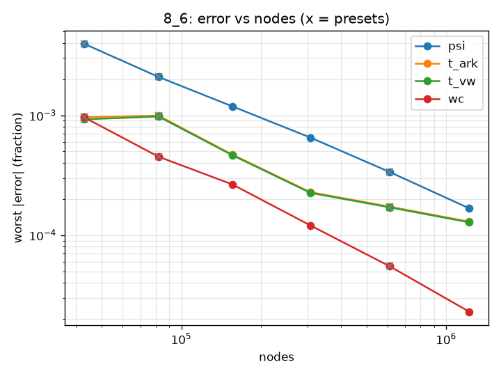
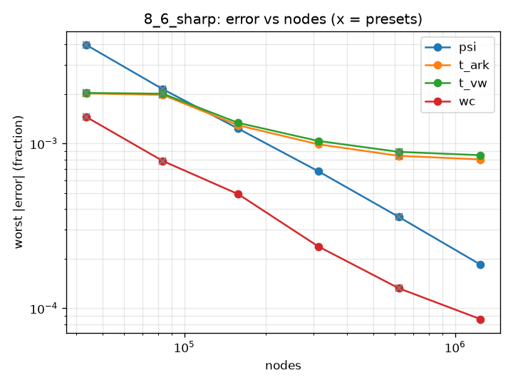
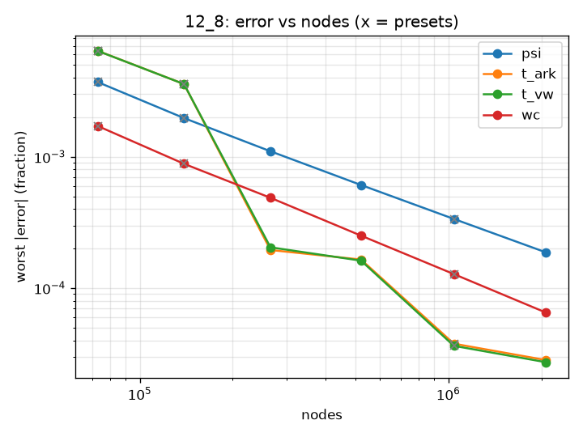
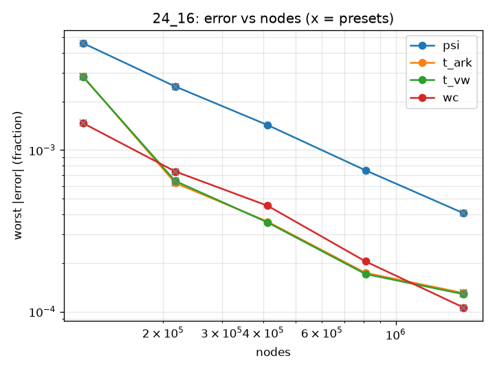
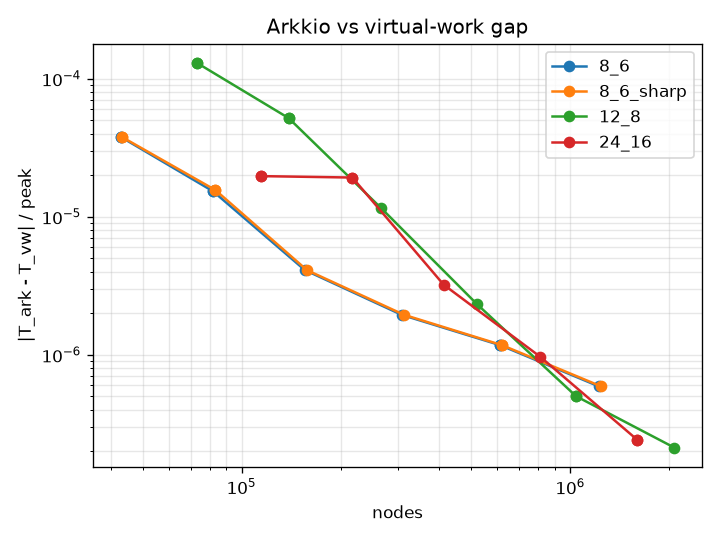

# M5a mesh convergence study

Generated by `examples/mesh_convergence.py report`. Errors are percent.

## Method

Per design and quantity the k-level series (h = scale) is fitted with q = qinf + C h^p by least squares (`scipy.optimize.curve_fit`). psi and W' errors are relative to |qinf|; torque errors are relative to the design's peak torque at I_max (largest |T_ark| of the finest level at tau/12 and tau/6). Torque is fitted at I_max only. A quantity is flagged when p is outside [0.5, 3], the series is not monotone, the fit fails, or fewer than 4 levels exist. For a flagged quantity qinf = q_finest, the GCI-style bound is U = 3 x |q_finest - q_second| (normalised like the errors), and the error of every row (each level including the finest, and each preset) is |q - q_finest| / norm + U. A series whose successive differences are all below 1e-12 of its magnitude counts as converged (qinf = q_finest, U = 0, not flagged). A quantity present at only one level is dropped. Each design/level appears once (the last run wins).

## Design 8_6

I_max = 20 A

| level | scale | nodes | elements | band divisions | mesh s | peak GB |
|---|---|---|---|---|---|---|
| 0 | 1 | 42935 | 85712 | 864 | 10.4 | 0.34 |
| 1 | 0.7071 | 81984 | 163746 | 1224 | 15.4 | 0.49 |
| 2 | 0.5 | 155730 | 311146 | 1728 | 25.2 | 0.79 |
| 3 | 0.3536 | 307223 | 614004 | 2448 | 45.8 | 1.28 |
| 4 | 0.25 | 612292 | 1223959 | 3456 | 33.1 | 2.20 |
| 5 | 0.1768 | 1221795 | 2442708 | 4896 | 60.4 | 4.37 |
| screening | 1 | 42935 | 85712 | 864 | 9.9 | 0.34 |
| full | 1 | 81984 | 163746 | 1224 | 14.9 | 0.50 |
| reference | 1 | 612292 | 1223959 | 3456 | 87.0 | 2.03 |

Peak torque at I_max: 11.3221 N m

| quantity | state | p | qinf | fit rms | flag | 0 | 1 | 2 | 3 | 4 | 5 | screening | full | reference |
|---|---|---|---|---|---|---|---|---|---|---|---|---|---|---|
| psi | aligned_imax | 1.958 | 0.320422 | 5.19e-06 | - | 0.0788 | 0.03719 | 0.02308 | 0.01013 | 0.004596 | 0.00229 | 0.0788 | 0.03719 | 0.004596 |
| wc | aligned_imax | 2.009 | 4.60064 | 7.26e-05 | - | 0.09625 | 0.04516 | 0.02653 | 0.01205 | 0.005496 | 0.002299 | 0.09625 | 0.04516 | 0.005496 |
| psi | aligned_ila | 1.674 | 0.0329163 | 8.19e-07 | - | 0.2656 | 0.1436 | 0.08628 | 0.04795 | 0.02556 | 0.01303 | 0.2656 | 0.1436 | 0.02556 |
| psi | tau/12_imax | 1.998 | 0.308596 | 3.76e-06 | - | 0.09429 | 0.045 | 0.02562 | 0.01194 | 0.005525 | 0.002472 | 0.09429 | 0.045 | 0.005525 |
| t_ark | tau/12_imax | 2.726 | -6.50036 | 0.000874 | non-monotone | 0.06298 | 0.03702 | 0.01426 | 0.005956 | 0.007314 | 0.005485 | 0.06298 | 0.03702 | 0.007314 |
| t_vw | tau/12_imax | 2.731 | -6.50036 | 0.000884 | non-monotone | 0.06595 | 0.03826 | 0.01418 | 0.006132 | 0.007443 | 0.005582 | 0.06595 | 0.03826 | 0.007443 |
| psi | tau/12_ila | 1.774 | 0.0282107 | 6.01e-07 | - | 0.2994 | 0.1577 | 0.08985 | 0.04909 | 0.02523 | 0.01219 | 0.2994 | 0.1577 | 0.02523 |
| psi | tau/6_imax | 1.864 | 0.263225 | 1.33e-06 | - | 0.1458 | 0.07556 | 0.04078 | 0.02117 | 0.01048 | 0.005812 | 0.1458 | 0.07556 | 0.01048 |
| t_ark | tau/6_imax | 0.603 | -11.3221 | 0.00132 | non-monotone | 0.0964 | 0.0994 | 0.04703 | 0.02284 | 0.01728 | 0.01296 | 0.0964 | 0.0994 | 0.01728 |
| t_vw | tau/6_imax | 0.554 | -11.3221 | 0.00133 | non-monotone | 0.0925 | 0.09775 | 0.0465 | 0.02253 | 0.01705 | 0.01279 | 0.0925 | 0.09775 | 0.01705 |
| psi | tau/6_ila | 1.768 | 0.0214909 | 5.61e-07 | - | 0.3952 | 0.2091 | 0.1188 | 0.06516 | 0.03361 | 0.01643 | 0.3952 | 0.2091 | 0.03361 |
| psi | tau/2_ila | 1.797 | 0.00359585 | 1.55e-08 | - | 0.3696 | 0.1991 | 0.1059 | 0.05668 | 0.03068 | 0.01674 | 0.3696 | 0.1991 | 0.03068 |

## Design 8_6_sharp

I_max = 20 A

| level | scale | nodes | elements | band divisions | mesh s | peak GB |
|---|---|---|---|---|---|---|
| 0 | 1 | 43403 | 86648 | 864 | 10.7 | 0.34 |
| 1 | 0.7071 | 83294 | 166366 | 1224 | 15.2 | 0.50 |
| 2 | 0.5 | 158167 | 316020 | 1728 | 11.9 | 0.80 |
| 3 | 0.3536 | 312182 | 623922 | 2448 | 21.5 | 1.29 |
| 4 | 0.25 | 620342 | 1240059 | 3456 | 32.6 | 2.23 |
| 5 | 0.1768 | 1240777 | 2480672 | 4896 | 62.6 | 4.44 |
| screening | 1 | 43403 | 86648 | 864 | 11.2 | 0.34 |
| full | 1 | 83294 | 166366 | 1224 | 15.9 | 0.50 |
| reference | 1 | 620342 | 1240059 | 3456 | 84.8 | 2.03 |

Peak torque at I_max: 11.2533 N m

| quantity | state | p | qinf | fit rms | flag | 0 | 1 | 2 | 3 | 4 | 5 | screening | full | reference |
|---|---|---|---|---|---|---|---|---|---|---|---|---|---|---|
| psi | aligned_imax | 1.630 | 0.320215 | 9.7e-06 | - | 0.1399 | 0.07502 | 0.05064 | 0.02338 | 0.01367 | 0.008628 | 0.1399 | 0.07502 | 0.01367 |
| wc | aligned_imax | 1.674 | 4.60026 | 9.72e-05 | - | 0.1451 | 0.07838 | 0.04931 | 0.02377 | 0.01323 | 0.008599 | 0.1451 | 0.07838 | 0.01323 |
| psi | aligned_ila | 1.656 | 0.0329779 | 7.77e-07 | - | 0.2726 | 0.1488 | 0.08942 | 0.05004 | 0.02696 | 0.01401 | 0.2726 | 0.1488 | 0.02696 |
| psi | tau/12_imax | 1.597 | 0.308791 | 7.06e-06 | - | 0.1468 | 0.08167 | 0.05263 | 0.0255 | 0.01509 | 0.01009 | 0.1468 | 0.08167 | 0.01509 |
| t_ark | tau/12_imax | 0.642 | -6.39495 | 0.00108 | non-monotone | 0.1102 | 0.06556 | 0.07195 | 0.02882 | 0.01533 | 0.0115 | 0.1102 | 0.06556 | 0.01533 |
| t_vw | tau/12_imax | 0.589 | -6.39496 | 0.00108 | non-monotone | 0.1072 | 0.06434 | 0.07168 | 0.02865 | 0.0152 | 0.0114 | 0.1072 | 0.06434 | 0.0152 |
| psi | tau/12_ila | 1.726 | 0.0282745 | 5.39e-07 | - | 0.3031 | 0.1629 | 0.09388 | 0.05175 | 0.02726 | 0.01396 | 0.3031 | 0.1629 | 0.02726 |
| psi | tau/6_imax | 1.583 | 0.264242 | 3.68e-06 | - | 0.1572 | 0.09311 | 0.05236 | 0.02853 | 0.01677 | 0.01194 | 0.1572 | 0.09311 | 0.01677 |
| t_ark | tau/6_imax | 0.631 | -11.2623 | 0.00153 | - | 0.2015 | 0.1971 | 0.1289 | 0.09892 | 0.08415 | 0.08006 | 0.2015 | 0.1971 | 0.08415 |
| t_vw | tau/6_imax | 0.596 | -11.2629 | 0.00154 | - | 0.2027 | 0.2005 | 0.1334 | 0.1037 | 0.08896 | 0.08493 | 0.2027 | 0.2005 | 0.08896 |
| psi | tau/6_ila | 1.723 | 0.0215578 | 5.29e-07 | - | 0.3969 | 0.2136 | 0.1231 | 0.06794 | 0.03581 | 0.01841 | 0.3969 | 0.2136 | 0.03581 |
| psi | tau/2_ila | 1.825 | 0.00367255 | 1.79e-08 | - | 0.3767 | 0.1994 | 0.1072 | 0.05625 | 0.02983 | 0.01595 | 0.3767 | 0.1994 | 0.02983 |

## Design 12_8

I_max = 10 A

| level | scale | nodes | elements | band divisions | mesh s | peak GB |
|---|---|---|---|---|---|---|
| 0 | 1 | 73113 | 146083 | 1440 | 9.9 | 0.45 |
| 1 | 0.7071 | 139057 | 277913 | 2016 | 13.8 | 0.70 |
| 2 | 0.5 | 265106 | 529928 | 2880 | 28.1 | 1.23 |
| 3 | 0.3536 | 521091 | 1041782 | 4032 | 89.4 | 2.04 |
| 4 | 0.25 | 1041515 | 2082465 | 5760 | 86.8 | 3.73 |
| 5 | 0.1768 | 2071551 | 4142305 | 8160 | 112.4 | 7.11 |
| screening | 1 | 73113 | 146083 | 1440 | 16.7 | 0.45 |
| full | 1 | 139057 | 277913 | 2016 | 25.7 | 0.71 |
| reference | 1 | 1041515 | 2082465 | 5760 | 220.5 | 3.71 |

Peak torque at I_max: 2.76473 N m

| quantity | state | p | qinf | fit rms | flag | 0 | 1 | 2 | 3 | 4 | 5 | screening | full | reference |
|---|---|---|---|---|---|---|---|---|---|---|---|---|---|---|
| psi | aligned_imax | 1.977 | 0.164424 | 6.38e-07 | - | 0.1273 | 0.06348 | 0.03262 | 0.01683 | 0.008042 | 0.003829 | 0.1273 | 0.06348 | 0.008042 |
| wc | aligned_imax | 1.856 | 0.832481 | 7.37e-06 | - | 0.1712 | 0.08832 | 0.04866 | 0.02506 | 0.01277 | 0.0065 | 0.1712 | 0.08832 | 0.01277 |
| psi | aligned_ila | 1.610 | 0.00772909 | 8.43e-08 | - | 0.2281 | 0.1284 | 0.0763 | 0.04299 | 0.02417 | 0.01357 | 0.2281 | 0.1284 | 0.02417 |
| psi | tau/12_imax | 1.992 | 0.139782 | 7.47e-08 | - | 0.15 | 0.07515 | 0.03777 | 0.01893 | 0.009396 | 0.004778 | 0.15 | 0.07515 | 0.009396 |
| t_ark | tau/12_imax | 9.492 | -2.61819 | 0.000251 | p out of range, non-monotone | 0.6399 | 0.02735 | 0.01948 | 0.01648 | 0.00377 | 0.002827 | 0.6399 | 0.02735 | 0.00377 |
| t_vw | tau/12_imax | 10.122 | -2.6182 | 0.000256 | p out of range, non-monotone | 0.6389 | 0.02208 | 0.02043 | 0.01616 | 0.00363 | 0.002723 | 0.6389 | 0.02208 | 0.00363 |
| psi | tau/12_ila | 1.658 | 0.00653473 | 6.55e-08 | - | 0.2596 | 0.1442 | 0.08376 | 0.04645 | 0.02568 | 0.01434 | 0.2596 | 0.1442 | 0.02568 |
| psi | tau/6_imax | 1.986 | 0.104669 | 1.76e-07 | - | 0.1987 | 0.1001 | 0.05013 | 0.02499 | 0.01255 | 0.006614 | 0.1987 | 0.1001 | 0.01255 |
| t_ark | tau/6_imax | 0.000 | -2.76473 | 0.00332 | p out of range, non-monotone | 0.0169 | 0.3576 | 0.01589 | 0.01474 | 0.003383 | 0.002537 | 0.0169 | 0.3576 | 0.003383 |
| t_vw | tau/6_imax | 0.000 | -2.76473 | 0.00338 | p out of range, non-monotone | 0.003818 | 0.3574 | 0.01697 | 0.01447 | 0.003296 | 0.002472 | 0.003818 | 0.3574 | 0.003296 |
| psi | tau/6_ila | 1.663 | 0.00494989 | 6.77e-08 | - | 0.3419 | 0.1895 | 0.11 | 0.06089 | 0.03359 | 0.01868 | 0.3419 | 0.1895 | 0.03359 |
| psi | tau/2_ila | 1.813 | 0.000747923 | 3.11e-09 | - | 0.3698 | 0.1969 | 0.1057 | 0.05635 | 0.02923 | 0.01632 | 0.3698 | 0.1969 | 0.02923 |

## Design 24_16

I_max = 40 A

| level | scale | nodes | elements | band divisions | mesh s | peak GB |
|---|---|---|---|---|---|---|
| 0 | 1 | 114926 | 229666 | 1920 | 41.2 | 0.61 |
| 1 | 0.7071 | 217331 | 434401 | 2688 | 73.1 | 1.01 |
| 2 | 0.5 | 411732 | 823095 | 3648 | 83.6 | 1.81 |
| 3 | 0.3536 | 810852 | 1621184 | 5184 | 62.9 | 3.07 |
| 4 | 0.25 | 1599310 | 3197885 | 7296 | 97.3 | 5.66 |
| screening | 1 | 114926 | 229666 | 1920 | 22.8 | 0.59 |
| full | 1 | 217331 | 434401 | 2688 | 38.8 | 1.01 |
| reference | 1 | 1599310 | 3197885 | 7296 | 183.8 | 5.27 |

Peak torque at I_max: 12.9099 N m

| quantity | state | p | qinf | fit rms | flag | 0 | 1 | 2 | 3 | 4 | screening | full | reference |
|---|---|---|---|---|---|---|---|---|---|---|---|---|---|
| psi | aligned_imax | 2.038 | 0.0805033 | 2.19e-06 | - | 0.0543 | 0.02298 | 0.01778 | 0.005416 | 0.002181 | 0.0543 | 0.02298 | 0.002181 |
| wc | aligned_imax | 1.840 | 1.99369 | 5.19e-05 | - | 0.1467 | 0.07373 | 0.04524 | 0.02046 | 0.0106 | 0.1467 | 0.07373 | 0.0106 |
| psi | aligned_ila | 1.609 | 0.00531283 | 1.49e-07 | - | 0.3085 | 0.1723 | 0.1056 | 0.05663 | 0.03228 | 0.3085 | 0.1723 | 0.03228 |
| psi | tau/12_imax | 2.034 | 0.0771948 | 1.94e-06 | - | 0.07373 | 0.03285 | 0.02218 | 0.008055 | 0.003309 | 0.07373 | 0.03285 | 0.003309 |
| t_ark | tau/12_imax | 44.048 | -9.11153 | 0.00315 | p out of range, non-monotone | 0.1429 | 0.06259 | 0.02501 | 0.009792 | 0.007344 | 0.1429 | 0.06259 | 0.007344 |
| t_vw | tau/12_imax | 49.815 | -9.11154 | 0.00322 | p out of range, non-monotone | 0.1415 | 0.06439 | 0.0248 | 0.009913 | 0.007434 | 0.1415 | 0.06439 | 0.007434 |
| psi | tau/12_ila | 1.735 | 0.0045664 | 1.08e-07 | - | 0.3533 | 0.19 | 0.1098 | 0.05742 | 0.03088 | 0.3533 | 0.19 | 0.03088 |
| psi | tau/6_imax | 1.897 | 0.0661147 | 4.45e-07 | - | 0.1561 | 0.07997 | 0.04304 | 0.02128 | 0.01112 | 0.1561 | 0.07997 | 0.01112 |
| t_ark | tau/6_imax | 44.818 | -12.9099 | 0.00107 | p out of range, non-monotone | 0.2857 | 0.01453 | 0.03606 | 0.01738 | 0.01303 | 0.2857 | 0.01453 | 0.01303 |
| t_vw | tau/6_imax | 53.187 | -12.9099 | 0.0011 | p out of range, non-monotone | 0.2835 | 0.01322 | 0.03566 | 0.01709 | 0.01281 | 0.2835 | 0.01322 | 0.01281 |
| psi | tau/6_ila | 1.729 | 0.00354265 | 1.01e-07 | - | 0.4586 | 0.2475 | 0.1429 | 0.07494 | 0.04062 | 0.4586 | 0.2475 | 0.04062 |
| psi | tau/2_ila | 1.896 | 0.000807153 | 1.84e-09 | - | 0.4233 | 0.2191 | 0.114 | 0.05908 | 0.03035 | 0.4233 | 0.2191 | 0.03035 |

## Summary against targets

Worst error over all designs and quantities. Target columns are the spec section 5 values; pass is against the target, margin against target/2.

| preset | psi/W' worst | target | pass | margin | torque worst | target | pass | margin |
|---|---|---|---|---|---|---|---|---|
| screening | 0.4586 | 2 | pass | pass | 0.6399 | 3 | pass | pass |
| full | 0.2475 | 0.5 | pass | pass | 0.3576 | 1 | pass | pass |
| reference | 0.04062 | 0.1 | pass | pass | 0.08896 | 0.2 | pass | pass |

| level | psi/W' worst | torque worst |
|---|---|---|
| 0 | 0.4586 | 0.6399 |
| 1 | 0.2475 | 0.3576 |
| 2 | 0.1429 | 0.1334 |
| 3 | 0.07494 | 0.1037 |
| 4 | 0.04062 | 0.08896 |
| 5 | 0.01868 | 0.08493 |

## Grid-error split (full preset)

| design | angle-only psi | angle-only torque | current-only psi | current-only torque | band rms |
|---|---|---|---|---|---|
| 8_6 | 0.004161 | 0.2696 | 0.02454 | 0.01206 | 0.1514 |
| 8_6_sharp | 0.004115 | 0.265 | 0.0257 | 0.008002 | 0.1508 |
| 12_8 | 0.009447 | 0.31 | 0.06063 | 0.01482 | 0.4724 |
| 24_16 | 0.008034 | 0.1968 | 0.04822 | 0.05274 | 0.3481 |
