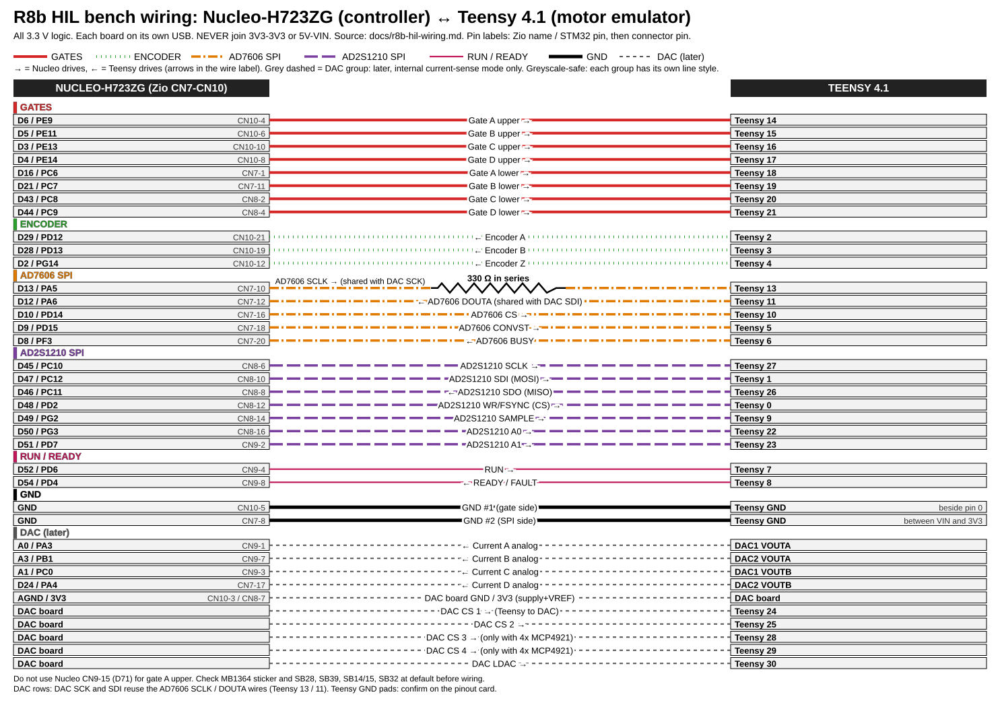

# R8b HIL bench: wiring steps

Print the SVG on A4 landscape. Pin source: [r8b-hil-wiring.md](r8b-hil-wiring.md). Wire colours below match the drawing's groups (suggestions only).
Nucleo pins are Zio labels (CN7-CN10 side headers). Teensy pins are the printed numbers.

## Step 0: safety

- [ ] Unplug USB from both boards.
- [ ] Never join Nucleo 3V3 to Teensy 3V3.
- [ ] Never join Nucleo 5V to Teensy VIN.
- [ ] Never connect any 5 V signal to a Teensy pin (not 5 V tolerant).
- [ ] Check the Nucleo sticker says MB1364.
- [ ] Check solder bridges at default: SB28 ON, SB39 ON, SB14 ON, SB15 ON, SB32 ON.
- [ ] Check JP5 is on 3V3.
- [ ] Have the Teensy pinout card ready (for the GND pads).

## Step 1: GND (2 wires)

| From (Nucleo) | To (Teensy) | Colour |
|---|---|---|
| CN10-5 (GND) | GND pad beside pin 0 | black |
| CN7-8 (GND) | GND between VIN and 3V3 | black |

- [ ] Both wires in. Boards share ground.

## Step 2: gates (8 wires, Nucleo drives)

| From (Nucleo) | To (Teensy) | Signal | Colour |
|---|---|---|---|
| D6 / PE9 (CN10-4) | 14 | Gate A upper | red |
| D5 / PE11 (CN10-6) | 15 | Gate B upper | red |
| D3 / PE13 (CN10-10) | 16 | Gate C upper | red |
| D4 / PE14 (CN10-8) | 17 | Gate D upper | red |
| D16 / PC6 (CN7-1) | 18 | Gate A lower | red |
| D21 / PC7 (CN7-11) | 19 | Gate B lower | red |
| D43 / PC8 (CN8-2) | 20 | Gate C lower | red |
| D44 / PC9 (CN8-4) | 21 | Gate D lower | red |

- [ ] 8 wires. Do not use CN9-15 (D71) for D6.

## Step 3: encoder (3 wires, Teensy drives)

| From (Teensy) | To (Nucleo) | Signal | Colour |
|---|---|---|---|
| 2 | D29 / PD12 (CN10-21) | Encoder A | green |
| 3 | D28 / PD13 (CN10-19) | Encoder B | green |
| 4 | D2 / PG14 (CN10-12) | Encoder Z | green |

- [ ] 3 wires.

## Step 4: AD7606 group (5 wires + 330 Ω)

| From | To | Signal | Colour |
|---|---|---|---|
| Nucleo D13 / PA5 (CN7-10) | **330 Ω resistor**, then Teensy 13 | SCLK (Nucleo drives) | orange |
| Teensy 11 | Nucleo D12 / PA6 (CN7-12) | DOUTA | orange |
| Nucleo D10 / PD14 (CN7-16) | Teensy 10 | CS | orange |
| Nucleo D9 / PD15 (CN7-18) | Teensy 5 | CONVST | orange |
| Teensy 6 | Nucleo D8 / PF3 (CN7-20) | BUSY | orange |

- [ ] 330 Ω is in series on the SCLK wire (one resistor, two legs, either order).
- [ ] Nucleo D11 (MOSI) stays unwired.
- [ ] 5 wires.

## Step 5: AD2S1210 group (7 wires)

| From | To | Signal | Colour |
|---|---|---|---|
| Nucleo D45 / PC10 (CN8-6) | Teensy 27 | SCLK | purple |
| Nucleo D47 / PC12 (CN8-10) | Teensy 1 | SDI (MOSI) | purple |
| Teensy 26 | Nucleo D46 / PC11 (CN8-8) | SDO (MISO) | purple |
| Nucleo D48 / PD2 (CN8-12) | Teensy 0 | WR/FSYNC (CS) | purple |
| Nucleo D49 / PG2 (CN8-14) | Teensy 9 | SAMPLE | purple |
| Nucleo D50 / PG3 (CN8-16) | Teensy 22 | A0 | purple |
| Nucleo D51 / PD7 (CN9-2) | Teensy 23 | A1 | purple |

- [ ] 7 wires. Leave Teensy Serial1 (pins 0, 1) unused in firmware.

## Step 6: RUN / READY (2 wires)

| From | To | Signal | Colour |
|---|---|---|---|
| Nucleo D52 / PD6 (CN9-4) | Teensy 7 | RUN | yellow |
| Teensy 8 | Nucleo D54 / PD4 (CN9-8) | READY / FAULT | yellow |

- [ ] 2 wires.

## Step 7: continuity check (multimeter, both boards unpowered)

- [ ] Beep each of the 27 signal wires end to end (8 + 3 + 5 + 7 + 2 = 25 wires, plus 2 GND = 27).
- [ ] SCLK: expect about 330 Ω between D13 and Teensy 13.
- [ ] Every other signal: under 1 Ω.
- [ ] Nucleo 3V3 to Teensy 3V3: open (no beep).
- [ ] Nucleo 5V to Teensy VIN: open (no beep).
- [ ] Any signal pin to its neighbour: open.
- [ ] Any signal to GND: open.

## Step 8: power up

- [ ] Plug Teensy USB first (emulator up, outputs idle).
- [ ] Plug Nucleo USB second.
- [ ] Check both power LEDs.
- [ ] If anything smells hot or an LED is wrong: unplug both, go back to step 7.

## Step 9 (later): DAC group, internal current-sense mode only

Grey dashed lines in the drawing. Skip until needed.

| From | To | Signal | Colour |
|---|---|---|---|
| DAC1 VOUTA | Nucleo A0 / PA3 (CN9-1) | Current A | grey |
| DAC2 VOUTA | Nucleo A3 / PB1 (CN9-7) | Current B | grey |
| DAC1 VOUTB | Nucleo A1 / PC0 (CN9-3) | Current C | grey |
| DAC2 VOUTB | Nucleo D24 / PA4 (CN7-17) | Current D | grey |
| Teensy 24 | DAC CS 1 | CS | grey |
| Teensy 25 | DAC CS 2 | CS | grey |
| Teensy 28 | DAC CS 3 | only with 4x MCP4921 | grey |
| Teensy 29 | DAC CS 4 | only with 4x MCP4921 | grey |
| Teensy 30 | DAC LDAC | LDAC | grey |
| Teensy 13 / 11 | DAC SCK / SDI | tap the existing AD7606 SCLK / DOUTA wires | grey |
| Nucleo AGND (CN10-3) | DAC ground | | black |
| Nucleo 3V3 (CN8-7) | DAC supply and VREF | | grey |

- [ ] DAC VOUT must stay at or below 3.3 V (VREF from 3V3).
- [ ] In DAC mode Nucleo PA5 must be an input in firmware.
