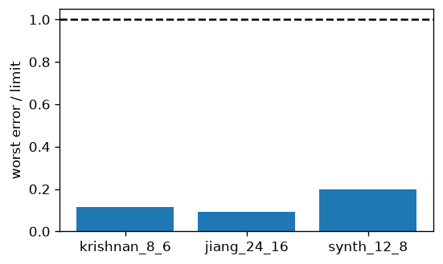
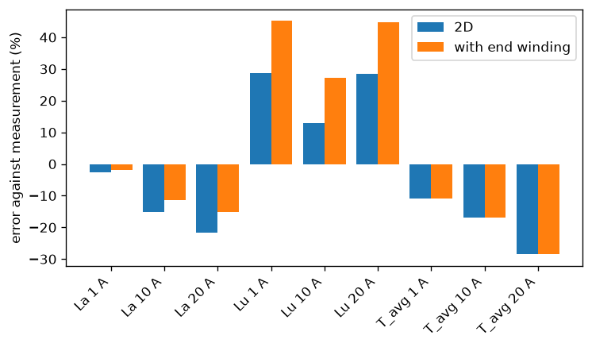
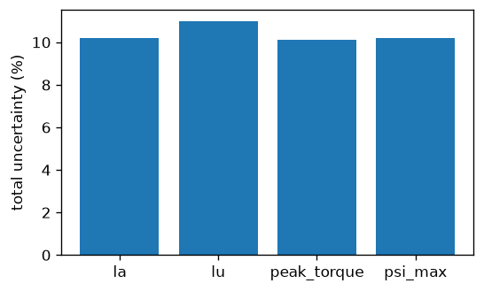

# srmcore validation report

**Verdict: PENDING**

- CI: pending

## Engine

| Package | Version | Licence |
|---|---|---|
| srmcore | 0.7.0 | not stated |
| numpy | 2.5.4 | BSD-3-Clause AND 0BSD AND MIT AND Zlib AND CC0-1.0 |
| scipy | 1.18.1 | BSD License |
| gmsh | 4.15.2 | GNU General Public License v2 or later (GPLv2+) |
| scikit-fem | 12.0.2 | BSD License |
| ngsolve | 6.2.2608 | LGPL-2.1-only |
| netgen-mesher | 6.2.2608 | LGPL-2.1-only |
| h5py | 3.16.0 | BSD-3-Clause |
| pydantic | 2.14.2 | MIT |
| matplotlib | 3.11.2 | Python Software Foundation License |

## Material library

| Material | Grade | Js | Stacking | Digitisation error | Provisional | Source |
|---|---|---|---|---|---|---|
| 10JNEX900 | B | 1.8 T | 0.9 | 2.50 % | — | JFE Technical Report No. 21 (Mar. 2016) p. 46, Fig. 1 'Direct current magnetizat |
| 10JNHF600 | B | 1.88 T | 0.9 | 1.00 % | — | JFE catalogue f2e-001 'Magnetic Property Curves', docs/sources/materials/jfe_f2e |
| 20JNHF1300 | B | 1.94 T | 0.92 | 1.00 % | — | JFE catalogue f2e-001 'Magnetic Property Curves', docs/sources/materials/jfe_f2e |
| Hiperco50A | B | 2.4 T | 0.95 | 1.50 % | stacking_factor | Carpenter Electrification datasheet Hiperco 50A (E199, v05-20), docs/sources/mat |
| Hiperco50HS_720C | C | 2.4 T | 0.95 | — | stacking_factor | Carpenter Electrification datasheet Hiperco 50 HS (E198, v05-20) p. 4 typical DC |
| Hiperco50HS_740C | C | 2.4 T | 0.95 | — | stacking_factor | Carpenter Electrification datasheet Hiperco 50 HS (E198, v05-20) p. 4 typical DC |
| Hiperco50HS_760C | C | 2.4 T | 0.95 | — | stacking_factor | Carpenter Electrification datasheet Hiperco 50 HS (E198, v05-20) p. 4 typical DC |
| M19 | C | 2.03 T | 0.98 | — | saturation_polarisation, density | FEMM 4.2 material library matlib.dat (github.com/cenit/FEMM, bin/matlib.dat), bl |
| M43 | C | 2.03 T | 0.98 | — | saturation_polarisation, density | FEMM 4.2 material library matlib.dat, block "M-43 Steel" (47 BH points, 45 used; |
| M530_50A | C | 2.03 T | 1 | — | stacking_factor, saturation_polarisation, density | EMDLAB material library materials/emdlab_mlib_es_M530_50A.m (github.com/EMDLAB-P |
| NO10_1270N | B | 2 T | 0.95 | 0.50 % | stacking_factor, saturation_polarisation | Tata Steel Hi-Lite datasheet NO10-1270N (Mar 2019), docs/sources/materials/tata_ |
| NO20 | B | 2 T | 0.95 | 0.50 % | stacking_factor, saturation_polarisation | Cogent brochure 'Electrical Steel Thin Non Oriented' (NO12 / NO18 / NO20, Cogent |
| NO20_1200H | B | 2 T | 0.95 | 0.50 % | stacking_factor, saturation_polarisation | Tata Steel Hi-Lite datasheet NO20-1200H (Mar 2019), docs/sources/materials/tata_ |
| Vacoflux48 | B | 2.3 T | 0.95 | 1.00 % | stacking_factor | VAC 'Soft magnetic cobalt-iron alloys VACOFLUX and VACODUR' (edition 2021), docs |
| Vacoflux50 | C | 2.3 T | 0.95 | — | stacking_factor | VAC 'Soft magnetic cobalt-iron alloys VACOFLUX and VACODUR' (edition 2021), docs |
| steel_1010 | C | 2.1 T | 1 | — | saturation_polarisation, density | FEMM 4.2 material library matlib.dat (github.com/cenit/FEMM, bin/matlib.dat), bl |

## M5a mesh convergence

Limits: psi 0.50 %, torque 1.70 %, band radius 1.00 %.

| Design | psi | torque | band radius | Status |
|---|---|---|---|---|
| 8_6 | 0.12 % | 0.54 % | 0.16 % | pass |
| 8_6_sharp | 0.12 % | 0.55 % | 0.16 % | pass |
| 12_8 | 0.01 % | 0.22 % | 0.11 % | pass |
| 24_16 | 0.09 % | 1.10 % | 0.48 % | pass |

## M5b TEAM 24

Report only (not gated).

srmcore 0.7.0.

| Quantity | Model | Measured | Error |
|---|---|---|---|
| static_torque | 2.79964 | 3.22 | -13.1 % |
| rotor_flux | 0.000390688 | 0.000472 | -17.2 % |
| current rise, max deviation | before 18.5647 % | after 8.09309 % | |

## M5c FEMM

Gate: ratio of the worst error to its limit is at most 1.

srmcore 0.7.0.

| Machine | worst psi | worst torque (rel) | worst torque (of peak) | Ratio | Status |
|---|---|---|---|---|---|
| krishnan_8_6 | 0.16 % | 0.34 % | 0.33 % | 0.115 | pass |
| jiang_24_16 | 0.14 % | 0.43 % | 0.33 % | 0.093 | pass |
| synth_12_8 | 0.11 % | 0.60 % | 0.45 % | 0.199 | pass |

## M5d Krishnan 6/4

Report only (not gated).

srmcore 0.7.0.

| Quantity | Current | Measured | 2D model | With end winding | Error 2D | Error corrected | Uncertainty |
|---|---|---|---|---|---|---|---|
| La (mH) | 1 A | 879 | 855.923 | 861.727 | -2.6 % | -2.0 % | 13.4 % |
| La (mH) | 10 A | 155 | 131.554 | 137.358 | -15.1 % | -11.4 % | 2.6 % |
| La (mH) | 20 A | 89 | 69.813 | 75.6173 | -21.6 % | -15.0 % | 4.0 % |
| Lu (mH) | 1 A | 35.5 | 45.7256 | 51.5298 | +28.8 % | +45.2 % | 28.3 % |
| Lu (mH) | 10 A | 40.7 | 46.0072 | 51.8115 | +13.0 % | +27.3 % | 26.1 % |
| Lu (mH) | 20 A | 35.6 | 45.7222 | 51.5264 | +28.4 % | +44.7 % | 28.4 % |
| T_avg (N·m) | 1 A | 0.9 | 0.801614 | 0.801614 | -10.9 % | -10.9 % | 16.7 % |
| T_avg (N·m) | 10 A | 20.3 | 16.8611 | 16.8611 | -16.9 % | -16.9 % | 3.3 % |
| T_avg (N·m) | 20 A | 41.6 | 29.7296 | 29.7296 | -28.5 % | -28.5 % | 6.3 % |

## EM validation (8/6 full)

Engine 0.7.0, label: none, grades {'stator': 'C', 'rotor': 'C'}, map 695 s, validation 289 s.

| Check | Status | Value | Limit | Detail |
|---|---|---|---|---|
| engine_version | fail | — | — | srmcore 0.7.0; validated versions: 0.4.0 |
| preset | pass | — | — | map preset full, design preset full; the label needs full or reference |
| map_identity | pass | — | — | map design hash 3e236049813f230f, this design 3e236049813f230f |
| no_filled_points | pass | 0 | 0 | points replaced by interpolation after a non-converged solve |
| map_matches_design | pass | 0 | 0.001 | peak-torque key-point solve on the design's own mesh against the map's value at that grid point |
| point_convergence_psi | pass | 0.00168433 | 0.005 | worst at lu (0.168%); full vs reference mesh ψ at the La, Lu and ψ_max points |
| point_convergence_torque | pass | 0.00116029 | 0.01 | worst at peak_torque (0.116%); full vs reference mesh torque at the peak-torque point, relative to peak torque |
| held_out_psi | pass | 0.0011721 | 0.005 | FEM ψ against the map interpolant at 64 held-out points, relative to ψ_max |
| held_out_torque | pass | 0.00543236 | 0.017 | FEM torque against the map interpolant at 64 held-out points, relative to peak torque |
| held_out_converged | pass | 0 | 0 | held-out solves skipped because they did not converge |
| band_radius | pass | 0.00159849 | 0.01 | Arkkio torque over each air-gap layer against the band at 3 angles and I_max, relative to peak torque |
| material_grade | pass | — | — | stator C, rotor C |
| budget_finite | pass | 0 | 0 | every budget total is finite |

Uncertainty budget (worst case, % of the corrected value):

| Source | la | lu | peak_torque | psi_max |
|---|---|---|---|---|
| 2D value | 0.032869 | 0.00358869 | 12.4356 | 0.320301 |
| corrected value | 0.0329986 | 0.00371827 | 12.4356 | 0.322893 |
| mesh | 0.12 | 0.16 | 0.12 | 0.03 |
| material | 9.96 | 9.65 | 10.00 | 9.92 |
| end_effect | 0.13 | 1.16 | 0.00 | 0.27 |
| digitisation | 0.00 | 0.00 | 0.00 | 0.00 |
| **total** | **10.21** | **10.98** | **10.12** | **10.22** |

## Speed

srmcore 0.7.0, 13th Gen Intel(R) Core(TM) i5-1340P, 16 logical CPUs, 8 workers, 2026-10-31.

| Design | Item | Seconds | Budget | Status |
|---|---|---|---|---|
| 8_6 | screening | 113.3 | 430.0 | pass |
| 8_6 | full | 694.2 | 2640.0 | pass |
| 8_6 | full_extras | 656.4 | 1860.0 | pass |
| 12_8 | screening | 161.7 | 430.0 | pass |
| 12_8 | full | 928.3 | 2640.0 | pass |
| 12_8 | full_extras | 445.7 | 1860.0 | pass |

## CI

Tag v0.7.0, run , result pending: pending
